<!--
Atak Domain (atakdomain): ICANN-akkreditierter Domain-Registrar seit 2003 (IANA-ID 1601). Domains, Hosting, geschäftliche E-Mail und SSL.
Website: https://www.atakdomain.com/de
-->

Wir sind <b>Atak Domain</b>, ein <b>ICANN-akkreditierter Domain-Registrar</b> (IANA-ID 1601) seit 2003. 
Domains, Hosting, geschäftliche E-Mail und SSL: von Ihrer ersten Website bis zur Marke, geschützt in <b>über 140 Ländern</b>.

##  Über uns

Atak Domain ist auf die Registrierung von Unternehmensdomains und die Verwaltung von Länderdomain-Portfolios (ccTLD) spezialisiert. Wir bieten **über 1.600 Endungen**, darunter Länderendungen von **über 220 Ländern und Gebieten**, sodass Sie Ihr gesamtes Domain-Portfolio in einem einzigen Panel registrieren und verwalten können. Unser Domain-Support-Team analysiert und verwaltet Ihre Domain-Strategie kostenlos.

- 🌍 **Domains weltweit:** .com, .com.tr, neue gTLDs und Länderdomains wie .de, .fr, .cn, .br und .ae
- 🏢 **Unternehmensmarken:** lokale Vertretung (Treuhand) in über 50 Ländern, Registry Lock, DNSSEC und Verletzungsüberwachung
- 🧩 **Agenturen und Reseller:** Massenabfrage, Sammeltransfer, Reseller-Preise, REST-API sowie Module für WHMCS und HostBill
- 🚚 **Hosting:** Ihre bestehende Website ziehen wir kostenlos um; tägliche automatische Backups der letzten 7 Tage
- 🎧 **Support:** unser Expertenteam ist rund um die Uhr für Sie da

> **Unsere Vision:** Als vertrauenswürdige Domain- und Digitalinfrastruktur-Marke weltweit die erste Wahl für Unternehmen und Gründer jeder Größe zu sein.

##  In Zahlen

Zahlen aus den Unterlagen von Atak Domain, Stand Oktober 2026.

##  Für wen wir da sind

Ihre erste Website, ein Portfolio aus hundert Domains oder eine Marke in 140 Ländern: Wo auch immer Sie starten, Ihr Weg ist bereit. Jede Karte öffnet die passende Seite.

##  In vier Schritten online

Alles, was Sie brauchen, von der Domain bis zur E-Mail, an einem Ort.

<a href="https://www.atakdomain.com/de/domain-check">Domain Check</a> ·
<a href="https://www.atakdomain.com/de/hosting">Webhosting</a> ·
<a href="https://www.atakdomain.com/de/business-email">Geschäftliche E-Mail</a> ·
<a href="https://www.atakdomain.com/de/ssl-zertifikat">SSL-Zertifikat</a>

##  Open Source

Werkzeuge, die wir für unsere eigene Arbeit entwickelt haben und mit allen teilen.

##  Womit wir entwickeln

Wir entwickeln unsere Plattform mit Technologien, die auf hohe Sicherheit ausgelegt sind.

##  Häufige Fragen

<b>Ist Atak Domain zuverlässig?</b>

 
Ja. Seit 2011 stehen wir auf der Liste der ICANN-akkreditierten Registrare. Mit unserer <b>IANA-ID 1601</b> bieten wir einen Service nach globalen Standards und in einer überprüfbaren Struktur. Sie können es <a href="https://www.icann.org/en/contracted-parties/accredited-registrars/list-of-accredited-registrars?page=1&amp;iana-number=1601">bei der ICANN prüfen</a>.

<b>Wie lange dauert ein Domaintransfer?</b>

 
In der Regel 5–7 Tage. Nach den ICANN-Regeln wird der Transfer automatisch bestätigt, wenn Ihr aktueller Anbieter nicht innerhalb von 5 Tagen reagiert. Seit der Erstregistrierung oder dem letzten Transfer müssen 60 Tage vergangen sein. Starten Sie beim <a href="https://www.atakdomain.com/de/domain-transfer">Domain-Transfer</a>.

<b>Bieten Sie einen Hosting-Umzug an?</b>

 
Ja, kostenlos. Unser Expertenteam überträgt Ihre Dateien, Datenbanken und E-Mails vollständig; die täglichen automatischen Backups der letzten 7 Tage werden aufbewahrt.

<b>Gibt es Whois-Schutz?</b>

 
Ja. Der Whois-Schutz (Domain Proxy) verhindert, dass Ihre Kontaktdaten in öffentlichen Whois-Abfragen sichtbar sind, und hilft, unerwünschte Anrufe und Spam-E-Mails zu reduzieren.

<b>Gibt es eine API für Reseller?</b>

 
Ja. Verkaufen Sie zu Reseller-Preisen und automatisieren Sie Registrierungen und Verlängerungen per REST-API oder mit den Modulen für WHMCS und HostBill. Mehr im <a href="https://www.atakdomain.com/de/domain-reseller">Domain-Reseller-Programm</a>.

##  Kontakt

 

ICANN-akkreditierter Registrar · IANA-ID 1601 

##  Links

Schneller Zugriff auf die Dienste von Atak Domain, beliebte Domain-Endungen und kostenlose Tools.

**Domains:** [Domain Check](https://www.atakdomain.com/de/domain-check) · [Günstige Domain](https://www.atakdomain.com/de/gunstige-domain) · [Domain-Preise](https://www.atakdomain.com/de/domain-preise) · [Domain-Transfer](https://www.atakdomain.com/de/domain-transfer) · [Massen-Domain-Check](https://www.atakdomain.com/de/massen-domainnamen-suche) · [Whois-Abfrage](https://www.atakdomain.com/de/whois-suche) · [Länderdomains (ccTLD)](https://www.atakdomain.com/de/cctld-lander-domains) · [Domainendungen](https://www.atakdomain.com/de/domainendungen) · [Kostenlose Domain](https://www.atakdomain.com/de/kostenloses-domain) · [Domain-Broker](https://www.atakdomain.com/de/domain-broker) · [Unternehmens-Domainverwaltung](https://www.atakdomain.com/de/domain-verwaltung) · [Treuhand-Service für Domains](https://www.atakdomain.com/de/treuhand-service) · [Domain-Reseller](https://www.atakdomain.com/de/domain-reseller)

**Beliebte Endungen:** [.com Domain kaufen](https://www.atakdomain.com/de/domain/com) · [.com.tr Domain registrieren](https://www.atakdomain.com/de/domain/turkei/com-tr) · [.tr Domain registrieren](https://www.atakdomain.com/de/domain/turkei/tr) · [.net Domain kaufen](https://www.atakdomain.com/de/domain/net) · [.org Domain kaufen](https://www.atakdomain.com/de/domain/org) · [.ai Domainregistrierung](https://www.atakdomain.com/de/domain/anguilla/ai) · [.si Domainregistrierung](https://www.atakdomain.com/de/domain/slowenien/si) · [.io Domainregistrierung](https://www.atakdomain.com/de/domain/britisches-territorium-des-indischen-ozeans/io) · [.de Domain registrieren](https://www.atakdomain.com/de/domain/deutschland/de)

**Hosting:** [Webhosting](https://www.atakdomain.com/de/hosting) · [WordPress Hosting](https://www.atakdomain.com/de/wordpress-hosting) · [Business-Hosting](https://www.atakdomain.com/de/business-hosting) · [Günstiges Webhosting](https://www.atakdomain.com/de/gunstiges-webhosting) · [Unbegrenztes Webhosting](https://www.atakdomain.com/de/unlimited-hosting) · [cPanel Hosting](https://www.atakdomain.com/de/cpanel-hosting) · [Linux Hosting](https://www.atakdomain.com/de/linux-hosting) · [E-Commerce Hosting](https://www.atakdomain.com/de/ecommerce-hosting) · [Managed Hosting](https://www.atakdomain.com/de/verwaltetes-hosting) · [Reseller-Hosting](https://www.atakdomain.com/de/reseller-hosting) · [Hosting-Preise](https://www.atakdomain.com/de/hosting-preise)

**E-Mail und SSL:** [Geschäftliche E-Mail](https://www.atakdomain.com/de/business-email) · [SSL-Zertifikat](https://www.atakdomain.com/de/ssl-zertifikat) · [RapidSSL](https://www.atakdomain.com/de/ssl-zertifikat/rapidssl-ssl) · [DigiCert SSL](https://www.atakdomain.com/de/ssl-zertifikat/digicert-ssl) · [Sectigo SSL](https://www.atakdomain.com/de/ssl-zertifikat/sectigo-ssl) · [Comodo SSL](https://www.atakdomain.com/de/ssl-zertifikat/comodo-ssl) · [GeoTrust SSL](https://www.atakdomain.com/de/ssl-zertifikat/geotrust-ssl) · [GlobalSign SSL](https://www.atakdomain.com/de/ssl-zertifikat/globalsign-ssl)

**Kostenlose Tools:** [DNS-Abfrage](https://www.atakdomain.com/de/dns-lookup) · [Was ist meine IP](https://www.atakdomain.com/de/wie-ist-meine-ip) · [MX Lookup](https://www.atakdomain.com/de/mx-suche) · [SPF-Abfrage](https://www.atakdomain.com/de/spf-suche) · [DKIM-Record-Checker](https://www.atakdomain.com/de/dkim-suche) · [DMARC-Eintrag prüfen](https://www.atakdomain.com/de/dmarc-suche) · [IDN-Konverter](https://www.atakdomain.com/de/idn-converter) · [CSR-Decoder](https://www.atakdomain.com/de/csr-decoder)

**Ratgeber:** [Was ist eine Domain?](https://www.atakdomain.com/de/blog/was-ist-eine-domain-registrieren) · [Was ist Hosting?](https://www.atakdomain.com/de/blog/was-ist-hosting) · [Was ist ein SSL-Zertifikat?](https://www.atakdomain.com/de/blog/was-ist-ein-ssl-zertifikat) · [Was ist geschäftliche E-Mail?](https://www.atakdomain.com/de/blog/was-ist-email-geschaeftliche-e-mail) · [Was ist ein Reseller?](https://www.atakdomain.com/de/blog/was-ist-ein-reseller-domains-hosting)
