<!--
Atak Domain (atakdomain): ICANN-accredited domain registrar since 2003 (IANA ID 1601). Domains, hosting, business e-mail and SSL.
Website: https://www.atakdomain.com
-->

We are <b>Atak Domain</b>, an <b>ICANN-accredited domain registrar</b> (IANA ID 1601) serving since 2003. 
Domains, hosting, business e-mail and SSL: from your first website to a brand protected in <b>140+ countries</b>.

##  About Us

Atak Domain specialises in corporate domain registration and country-code (ccTLD) portfolio management. We offer **1,600+ extensions**, including those of **220+ countries and territories**, so you can register and manage your whole domain portfolio from a single panel. Our domain support team analyses and manages your domain strategy free of charge.

- 🌍 **Domains everywhere:** .com, .com.tr, new gTLDs and ccTLDs such as .de, .fr, .cn, .br and .ae
- 🏢 **Corporate brands:** local presence (trustee) in 50+ countries, Registry Lock, DNSSEC and infringement monitoring
- 🧩 **Agencies and resellers:** bulk search, bulk transfer, reseller pricing, a REST API and WHMCS and HostBill modules
- 🚚 **Hosting:** we move your existing site for free and keep 7 days of daily automatic backups
- 🎧 **Support:** our experts are by your side 24/7

> **Our vision:** to be the first choice of businesses and entrepreneurs of every size as a trusted domain and digital infrastructure brand worldwide.

##  In Numbers

Figures from Atak Domain records, as of October 2026.

##  Who We Serve

It may be your first website, a portfolio of a hundred domains or a brand in 140 countries. Wherever you start, your path is ready. Each card opens the related page.

##  Live in Four Steps

Everything you need, from your domain name to your e-mail, in one place.

<a href="https://www.atakdomain.com/en/domain-name-search">Domain search</a> ·
<a href="https://www.atakdomain.com/en/hosting">Web hosting</a> ·
<a href="https://www.atakdomain.com/en/business-email">Business e-mail</a> ·
<a href="https://www.atakdomain.com/en/ssl-certificate">SSL certificates</a>

##  Open Source

Tools we built for our own work and share with everyone.

##  What We Build With

We build our platform with high-security technologies.

##  FAQ

<b>Is Atak Domain reliable?</b>

 
Yes. We have been listed among ICANN-accredited registrars since 2011. With our <b>IANA ID 1601</b>, we provide services in line with global standards and under an auditable structure. You can <a href="https://www.icann.org/en/contracted-parties/accredited-registrars/list-of-accredited-registrars?page=1&amp;iana-number=1601">verify it at ICANN</a>.

<b>How long does a domain transfer take?</b>

 
Usually 5 to 7 days. Under ICANN rules, the transfer is approved automatically if your current registrar does not respond within 5 days. At least 60 days must have passed since the registration or the last transfer. Start at <a href="https://www.atakdomain.com/en/domain-transfer">Domain Transfer</a>.

<b>Do you migrate hosting?</b>

 
Yes, free of charge. Our expert team moves your files, databases and e-mails completely, and daily automatic backups keep the last 7 days.

<b>Do you offer Whois privacy?</b>

 
Yes. Whois Privacy (Domain Proxy) keeps your contact details out of public Whois lookups, which helps prevent unwanted calls and spam.

<b>Is there an API for resellers?</b>

 
Yes. Sell to your customers at reseller prices and automate registrations and renewals with the REST API or the WHMCS and HostBill modules. See the <a href="https://www.atakdomain.com/en/domain-reseller">Domain Reseller Program</a>.

##  Connect

 

ICANN-Accredited Registrar · IANA ID 1601 

##  Links

Quick access to Atak Domain services, popular domain extensions and free tools.

**Domains:** [Domain name search](https://www.atakdomain.com/en/domain-name-search) · [Cheap domain names](https://www.atakdomain.com/en/cheap-domain) · [Domain prices](https://www.atakdomain.com/en/domain-prices) · [Domain transfer](https://www.atakdomain.com/en/domain-transfer) · [Bulk domain search](https://www.atakdomain.com/en/bulk-domain-name-search) · [Whois lookup](https://www.atakdomain.com/en/whois-search) · [Country code domains (ccTLD)](https://www.atakdomain.com/en/cctld-country-code-domain) · [Domain extensions](https://www.atakdomain.com/en/new-top-level-domains) · [Free domain](https://www.atakdomain.com/en/free-domain) · [Domain broker](https://www.atakdomain.com/en/domain-broker) · [Corporate domain management](https://www.atakdomain.com/en/domain-management) · [Domain trustee service](https://www.atakdomain.com/en/trustee-service) · [Domain reseller](https://www.atakdomain.com/en/domain-reseller)

**Popular extensions:** [Buy a .com domain](https://www.atakdomain.com/en/domain-registration/com) · [.com.tr domain registration](https://www.atakdomain.com/en/domain-registration/turkey/com-tr) · [.tr domain registration](https://www.atakdomain.com/en/domain-registration/turkey/tr) · [.net domain name](https://www.atakdomain.com/en/domain-registration/net) · [.org domain name](https://www.atakdomain.com/en/domain-registration/org) · [.ai domain registration](https://www.atakdomain.com/en/domain-registration/anguilla/ai) · [.si domain registration](https://www.atakdomain.com/en/domain-registration/slovenia/si) · [.io domain registration](https://www.atakdomain.com/en/domain-registration/british-indian-ocean-territory/io) · [.de domain registration](https://www.atakdomain.com/en/domain-registration/germany/de)

**Hosting:** [Web hosting](https://www.atakdomain.com/en/hosting) · [WordPress hosting](https://www.atakdomain.com/en/wordpress-hosting) · [Business hosting](https://www.atakdomain.com/en/business-hosting) · [Cheap hosting](https://www.atakdomain.com/en/cheap-hosting) · [Unlimited hosting](https://www.atakdomain.com/en/unlimited-hosting) · [cPanel hosting](https://www.atakdomain.com/en/cpanel-hosting) · [Linux hosting](https://www.atakdomain.com/en/linux-hosting) · [E-commerce hosting](https://www.atakdomain.com/en/ecommerce-hosting) · [Managed hosting](https://www.atakdomain.com/en/managed-hosting) · [Reseller hosting](https://www.atakdomain.com/en/reseller-hosting) · [Hosting prices](https://www.atakdomain.com/en/hosting-prices)

**E-mail and SSL:** [Business e-mail](https://www.atakdomain.com/en/business-email) · [SSL certificates](https://www.atakdomain.com/en/ssl-certificate) · [RapidSSL](https://www.atakdomain.com/en/ssl-certificate/rapidssl-ssl) · [DigiCert SSL](https://www.atakdomain.com/en/ssl-certificate/digicert-ssl) · [Sectigo SSL](https://www.atakdomain.com/en/ssl-certificate/sectigo-ssl) · [Comodo SSL](https://www.atakdomain.com/en/ssl-certificate/comodo-ssl) · [GeoTrust SSL](https://www.atakdomain.com/en/ssl-certificate/geotrust-ssl) · [GlobalSign SSL](https://www.atakdomain.com/en/ssl-certificate/globalsign-ssl)

**Free tools:** [DNS lookup](https://www.atakdomain.com/en/dns-lookup) · [What is my IP](https://www.atakdomain.com/en/what-is-my-ip) · [MX lookup](https://www.atakdomain.com/en/mx-lookup) · [SPF record checker](https://www.atakdomain.com/en/spf-search) · [DKIM record checker](https://www.atakdomain.com/en/dkim-search) · [DMARC record checker](https://www.atakdomain.com/en/dmarc-inquiry) · [IDN converter](https://www.atakdomain.com/en/idn-converter) · [CSR decoder](https://www.atakdomain.com/en/csr-decoder)

**Guides:** [What is a domain name?](https://www.atakdomain.com/en/blog/what-is-a-domain-name) · [What is hosting?](https://www.atakdomain.com/en/blog/what-is-hosting-what-does-it-do-and-how-to-choose) · [What is an SSL certificate?](https://www.atakdomain.com/en/blog/what-is-an-ssl-certificate-how-does-it-do-and-how-does-it-work) · [What is e-mail?](https://www.atakdomain.com/en/blog/what-is-email-why-should-you-use-an-email-address) · [What is a reseller?](https://www.atakdomain.com/en/blog/what-is-a-reseller)
