<!--
Atak Domain (atakdomain): аккредитованный ICANN регистратор доменов с 2003 года (IANA ID 1601). Домены, хостинг, корпоративная почта и SSL.
Сайт: https://www.atakdomain.com/ru
-->

Мы — <b>Atak Domain</b>, <b>аккредитованный ICANN регистратор доменов</b> (IANA ID 1601), работаем с 2003 года. 
Домены, хостинг, корпоративная почта и SSL: от первого сайта до бренда, защищённого в <b>140+ странах</b>.

##  О нас

Atak Domain специализируется на корпоративной регистрации доменов и управлении портфелями национальных доменов (ccTLD). Мы предлагаем **более 1 600 доменных зон**, включая зоны **более 220 стран и территорий**, поэтому весь доменный портфель можно регистрировать и вести в одной панели. Наша команда поддержки бесплатно анализирует и ведёт вашу доменную стратегию.

- 🌍 **Домены по всему миру:** .com, .com.tr, новые gTLD и национальные домены .de, .fr, .cn, .br и .ae
- 🏢 **Корпоративные бренды:** локальное представительство (trustee) в 50+ странах, Registry Lock, DNSSEC и мониторинг нарушений
- 🧩 **Агентства и реселлеры:** массовая проверка, массовый перенос, цены для реселлеров, REST API и модули для WHMCS и HostBill
- 🚚 **Хостинг:** бесплатно перенесём ваш текущий сайт; ежедневные автоматические резервные копии хранятся 7 дней
- 🎧 **Поддержка:** наши эксперты на связи 24/7

> **Наше видение:** стать первым выбором для компаний и предпринимателей любого масштаба как надёжный бренд доменов и цифровой инфраструктуры по всему миру.

##  В цифрах

Данные Atak Domain по состоянию на октябрь 2026 г.

##  Кому мы помогаем

Первый сайт, портфель из сотни доменов или бренд в 140 странах — с чего бы вы ни начали, путь уже готов. Каждая карточка открывает нужную страницу.

##  Сайт за четыре шага

Всё необходимое — от домена до почты — в одном месте.

<a href="https://www.atakdomain.com/ru/kupit-domen">Проверка домена</a> ·
<a href="https://www.atakdomain.com/ru/hosting">Веб-хостинг</a> ·
<a href="https://www.atakdomain.com/ru/korporativnaya-pochta">Корпоративная почта</a> ·
<a href="https://www.atakdomain.com/ru/ssl-sertifikat">SSL-сертификат</a>

##  Открытый код

Инструменты, которые мы сделали для своей работы и открыли для всех.

##  На чём мы разрабатываем

Мы разрабатываем платформу на технологиях с высоким уровнем безопасности.

##  Частые вопросы

<b>Надёжен ли Atak Domain?</b>

 
Да. С 2011 года мы входим в список аккредитованных ICANN регистраторов. С нашим номером <b>IANA ID 1601</b> мы предоставляем услуги в соответствии с глобальными стандартами и в проверяемой структуре. Это можно <a href="https://www.icann.org/en/contracted-parties/accredited-registrars/list-of-accredited-registrars?page=1&amp;iana-number=1601">проверить в ICANN</a>.

<b>Сколько длится перенос домена?</b>

 
Обычно 5–7 дней. По правилам ICANN, если текущий регистратор не ответит в течение 5 дней, перенос подтверждается автоматически. С момента первой регистрации или последнего переноса должно пройти 60 дней. Начните со страницы <a href="https://www.atakdomain.com/ru/perenos-domena">Перенос домена</a>.

<b>Выполняете ли вы перенос хостинга?</b>

 
Да, бесплатно. Наша команда полностью переносит ваши файлы, базы данных и почту, а ежедневные автоматические резервные копии хранятся 7 дней.

<b>Есть ли Whois Privacy?</b>

 
Да. Услуга Whois Privacy (Domain Proxy) скрывает ваши контактные данные в открытых Whois-запросах и помогает сократить количество нежелательных звонков и спам-писем.

<b>Есть ли API для реселлеров?</b>

 
Да. Продавайте по ценам для реселлеров и автоматизируйте регистрацию и продление через REST API или модули WHMCS и HostBill. Подробнее — в <a href="https://www.atakdomain.com/ru/domain-reseller">программе для реселлеров доменов</a>.

##  Контакты

 

Регистратор, аккредитованный ICANN · IANA ID 1601 

##  Ссылки

Быстрый доступ к услугам Atak Domain, популярным доменным зонам и бесплатным инструментам.

**Домены:** [Купить домен](https://www.atakdomain.com/ru/kupit-domen) · [Дешевые домены](https://www.atakdomain.com/ru/kupit-deshevyy-domen) · [Стоимость домена](https://www.atakdomain.com/ru/stoimost-domena) · [Перенос домена](https://www.atakdomain.com/ru/perenos-domena) · [Массовый поиск доменов](https://www.atakdomain.com/ru/massoviy-poisk-domenov) · [Whois-проверка домена](https://www.atakdomain.com/ru/whois-domen) · [Домены стран (ccTLD)](https://www.atakdomain.com/ru/cctld-domeny-stran) · [Доменные зоны](https://www.atakdomain.com/ru/new-top-level-domains) · [Бесплатный домен](https://www.atakdomain.com/ru/besplatnyy-domain) · [Доменный брокер](https://www.atakdomain.com/ru/domain-broker) · [Корпоративное управление доменами](https://www.atakdomain.com/ru/domen-menedzhment) · [Локальное представительство (trustee)](https://www.atakdomain.com/ru/trustee-service) · [Реселлер доменов](https://www.atakdomain.com/ru/domain-reseller)

**Популярные зоны:** [Купить домен .com](https://www.atakdomain.com/ru/kupit-domen/com) · [Домен .com.tr](https://www.atakdomain.com/ru/kupit-domen/turtsiya/com-tr) · [Домен .tr](https://www.atakdomain.com/ru/kupit-domen/turtsiya/tr) · [Купить домен .net](https://www.atakdomain.com/ru/kupit-domen/net) · [Домен .org](https://www.atakdomain.com/ru/kupit-domen/org) · [Регистрация домена .ai](https://www.atakdomain.com/ru/kupit-domen/angilya/ai) · [Регистрация домена .si](https://www.atakdomain.com/ru/kupit-domen/sloveniya/si) · [Домен .io](https://www.atakdomain.com/ru/kupit-domen/britanskaya-territoriya-indiyskogo-okeana/io) · [Домен .de](https://www.atakdomain.com/ru/kupit-domen/germaniya/de)

**Хостинг:** [Веб-хостинг](https://www.atakdomain.com/ru/hosting) · [WordPress хостинг](https://www.atakdomain.com/ru/wordpress-hosting) · [Корпоративный хостинг](https://www.atakdomain.com/ru/biznes-hosting) · [Дешевый хостинг](https://www.atakdomain.com/ru/deshevyy-khosting) · [Безлимитный хостинг](https://www.atakdomain.com/ru/unlimited-hosting) · [cPanel хостинг](https://www.atakdomain.com/ru/cpanel-hosting) · [Linux хостинг](https://www.atakdomain.com/ru/linux-hosting) · [Хостинг для интернет-магазина](https://www.atakdomain.com/ru/ecommerce-hosting) · [Управляемый хостинг](https://www.atakdomain.com/ru/managed-hosting) · [Реселлерский хостинг](https://www.atakdomain.com/ru/resellerskiy-khosting) · [Цены на хостинг](https://www.atakdomain.com/ru/hosting-prices)

**Почта и SSL:** [Корпоративная почта](https://www.atakdomain.com/ru/korporativnaya-pochta) · [SSL-сертификат](https://www.atakdomain.com/ru/ssl-sertifikat) · [RapidSSL](https://www.atakdomain.com/ru/ssl-sertifikat/rapidssl-ssl) · [DigiCert SSL](https://www.atakdomain.com/ru/ssl-sertifikat/digicert-ssl) · [Sectigo SSL](https://www.atakdomain.com/ru/ssl-sertifikat/sectigo-ssl) · [Comodo SSL](https://www.atakdomain.com/ru/ssl-sertifikat/comodo-ssl) · [GeoTrust SSL](https://www.atakdomain.com/ru/ssl-sertifikat/geotrust-ssl) · [GlobalSign SSL](https://www.atakdomain.com/ru/ssl-sertifikat/globalsign-ssl)

**Бесплатные инструменты:** [Проверка DNS](https://www.atakdomain.com/ru/dns-lookup) · [Мой IP](https://www.atakdomain.com/ru/moy-ip) · [Проверка MX-записи](https://www.atakdomain.com/ru/mx-lookup) · [Проверка SPF](https://www.atakdomain.com/ru/spf-search) · [Проверка DKIM](https://www.atakdomain.com/ru/dkim-search) · [Проверка DMARC](https://www.atakdomain.com/ru/dmarc-inquiry) · [Конвертер IDN](https://www.atakdomain.com/ru/idn-converter) · [CSR-декодер](https://www.atakdomain.com/ru/csr-decoder)

**Руководства:** [Что такое домен?](https://www.atakdomain.com/ru/blog/chto-takoe-domen-kak-zaregistrirovat) · [Что такое хостинг?](https://www.atakdomain.com/ru/blog/chto-takoe-hosting) · [Что такое SSL-сертификат?](https://www.atakdomain.com/ru/blog/chto-takoe-ssl-sertifikat) · [Что такое корпоративная почта?](https://www.atakdomain.com/ru/blog/chto-takoe-email-korporativnaya-pochta) · [Что такое реселлер?](https://www.atakdomain.com/ru/blog/chto-takoe-reseller-domenov-i-hostinga)
