<!--
Atak Domain (atakdomain): 2003'ten beri ICANN akrediteli domain kayıt kuruluşu (IANA ID 1601). Domain, hosting, kurumsal e-posta ve SSL.
Web sitesi: https://www.atakdomain.com
-->

Biz <b>Atak Domain</b>, 2003'ten beri hizmet veren, <b>ICANN akrediteli bir domain kayıt kuruluşuyuz</b> (IANA ID 1601). 
Domain, hosting, kurumsal e-posta ve SSL: ilk web sitenizden <b>140+ ülkede</b> korunan bir markaya kadar.

##  Hakkımızda

Atak Domain, kurumsal domain tescili ve ülke kodlu (ccTLD) domain portföy yönetiminde uzmanlaşmış bir kayıt kuruluşudur. **220'den fazla ülkenin** uzantısı dahil **1.600+ uzantıda** hizmet veriyoruz; tüm domain portföyünüzü tek panelden tescil edip yönetebilirsiniz. Domain destek ekibimiz domain stratejinizi ücretsiz analiz edip yönetir.

- 🌍 **Her yerde domain:** .com, .com.tr, yeni nesil uzantılar ve .de, .fr, .cn, .br, .ae gibi ülke kodlu domainler
- 🏢 **Kurumsal markalar:** 50'den fazla ülkede yerel temsil (vekillik), Registry Lock, DNSSEC ve ihlal takibi
- 🧩 **Ajans ve bayiler:** toplu sorgulama, toplu transfer, bayi fiyatları, REST API, WHMCS ve HostBill modülleri
- 🚚 **Hosting:** mevcut sitenizi ücretsiz taşıyoruz; günlük otomatik yedeklerin son 7 günü saklanır
- 🎧 **Destek:** uzman ekibimiz 7/24 yanınızda

> **Vizyonumuz:** dünyanın güvenilir domain ve dijital altyapı markası olarak her ölçekten işletmenin ve girişimcinin ilk tercihi olmak.

##  Rakamlarla Atak Domain

Rakamlar Atak Domain kayıtlarından, Ekim 2026 itibarıyladır.

##  Kimlere Hizmet Veriyoruz

İlk web siteniz, yüz domainlik bir portföyünüz ya da 140 ülkede bir markanız olabilir. Nereden başlarsanız başlayın, yolunuz hazır. Her kart ilgili sayfayı açar.

##  Dört Adımda Yayındasınız

Domaininizden e-postanıza kadar ihtiyacınız olan her şey tek yerde.

<a href="https://www.atakdomain.com/domain-sorgulama">Domain sorgulama</a> ·
<a href="https://www.atakdomain.com/hosting">Web hosting</a> ·
<a href="https://www.atakdomain.com/kurumsal-eposta">Kurumsal e-posta</a> ·
<a href="https://www.atakdomain.com/ssl-sertifikasi">SSL sertifikası</a>

##  Açık Kaynak

Kendi işimiz için yazıp herkesle paylaştığımız araçlar.

##  Neyle Geliştiriyoruz

Altyapımızı güvenliği yüksek teknolojilerle geliştiriyoruz.

##  Sıkça Sorulan Sorular

<b>Atak Domain güvenilir mi?</b>

 
Evet. 2011'den bu yana ICANN'in akredite kayıt kuruluşları listesinde yer alıyoruz. <b>IANA ID 1601</b> numaramızla küresel standartlarda ve denetlenebilir bir hizmet sunuyoruz. <a href="https://www.icann.org/en/contracted-parties/accredited-registrars/list-of-accredited-registrars?page=1&amp;iana-number=1601">ICANN'da doğrulayabilirsiniz</a>.

<b>Domain transferi ne kadar sürer?</b>

 
Genellikle 5–7 gün içinde tamamlanır. ICANN kuralları gereği mevcut firmanız 5 gün içinde yanıt vermezse transfer kendiliğinden onaylanır. İlk kayıt veya son transfer üzerinden 60 gün geçmiş olması gerekir. <a href="https://www.atakdomain.com/domain-transfer">Domain transferi</a> sayfasından başlayabilirsiniz.

<b>Hosting taşıma yapıyor musunuz?</b>

 
Evet, ücretsiz. Dosyalarınızı, veritabanlarınızı ve e-postalarınızı uzman ekibimizle eksiksiz taşıyoruz; günlük otomatik yedeklerin son 7 günü saklanır.

<b>Whois gizleme var mı?</b>

 
Evet. Whois Gizleme (Domain Proxy) hizmetiyle iletişim bilgileriniz herkese açık Whois sorgularında görünmez; istenmeyen aramaların ve spam e-postaların önüne geçmeye yardımcı olur.

<b>Bayiler için API var mı?</b>

 
Evet. Bayi fiyatlarıyla müşterilerinize satın; REST API ile ya da WHMCS ve HostBill modülleriyle kayıt ve yenilemeyi otomatikleştirin. Ayrıntılar <a href="https://www.atakdomain.com/domain-reseller">Domain reseller programı</a> sayfasında.

##  Bize Ulaşın

 

ICANN Akredite Kayıt Kuruluşu · IANA ID 1601 

##  Bağlantılar

Atak Domain hizmetlerine, popüler domain uzantılarına ve ücretsiz araçlara hızlı erişim.

**Domain:** [Domain sorgulama](https://www.atakdomain.com/domain-sorgulama) · [Ucuz domain](https://www.atakdomain.com/ucuz-domain) · [Domain fiyatları](https://www.atakdomain.com/domain-fiyatlari) · [Domain transfer](https://www.atakdomain.com/domain-transfer) · [Toplu domain sorgulama](https://www.atakdomain.com/toplu-domain-sorgulama) · [Whois sorgulama](https://www.atakdomain.com/whois-sorgulama) · [Ülke kodlu domain (ccTLD)](https://www.atakdomain.com/cctld-ulke-kodlu-domain) · [Domain uzantıları](https://www.atakdomain.com/tld-top-level-domain) · [Ücretsiz domain](https://www.atakdomain.com/ucretsiz-domain) · [Domain aracılık (broker)](https://www.atakdomain.com/domain-broker) · [Kurumsal domain yönetimi](https://www.atakdomain.com/domain-yonetimi) · [Domain vekillik hizmeti](https://www.atakdomain.com/vekillik-hizmeti) · [Domain reseller](https://www.atakdomain.com/domain-reseller)

**Popüler uzantılar:** [.com domain satın al](https://www.atakdomain.com/domain-sorgulama/com) · [.com.tr domain tescil](https://www.atakdomain.com/domain-sorgulama/turkiye/com-tr) · [.tr domain satın al](https://www.atakdomain.com/domain-sorgulama/turkiye/tr) · [.net domain](https://www.atakdomain.com/domain-sorgulama/net) · [.org domain](https://www.atakdomain.com/domain-sorgulama/org) · [.ai domain kaydı](https://www.atakdomain.com/domain-sorgulama/anguilla/ai) · [.si domain kaydı](https://www.atakdomain.com/domain-sorgulama/slovenya/si) · [.io domain kaydı](https://www.atakdomain.com/domain-sorgulama/ingiliz-hint-okyanusu-topragi/io) · [.de domain tescil](https://www.atakdomain.com/domain-sorgulama/almanya/de)

**Hosting:** [Web hosting](https://www.atakdomain.com/hosting) · [WordPress hosting](https://www.atakdomain.com/wordpress-hosting) · [Kurumsal hosting](https://www.atakdomain.com/kurumsal-hosting) · [Ucuz hosting](https://www.atakdomain.com/ucuz-hosting) · [Sınırsız hosting](https://www.atakdomain.com/limitsiz-hosting) · [cPanel hosting](https://www.atakdomain.com/cpanel-hosting) · [Linux hosting](https://www.atakdomain.com/linux-hosting) · [E-ticaret hosting](https://www.atakdomain.com/eticaret-hosting) · [Yönetilen hosting](https://www.atakdomain.com/yonetilen-hosting) · [Bayi hosting](https://www.atakdomain.com/bayi-hosting) · [Hosting fiyatları](https://www.atakdomain.com/hosting-fiyatlari)

**E-posta ve SSL:** [Kurumsal e-posta](https://www.atakdomain.com/kurumsal-eposta) · [SSL sertifikası](https://www.atakdomain.com/ssl-sertifikasi) · [RapidSSL](https://www.atakdomain.com/ssl-sertifikasi/rapidssl-ssl) · [DigiCert SSL](https://www.atakdomain.com/ssl-sertifikasi/digicert-ssl) · [Sectigo SSL](https://www.atakdomain.com/ssl-sertifikasi/sectigo-ssl) · [Comodo SSL](https://www.atakdomain.com/ssl-sertifikasi/comodo-ssl) · [GeoTrust SSL](https://www.atakdomain.com/ssl-sertifikasi/geotrust-ssl) · [GlobalSign SSL](https://www.atakdomain.com/ssl-sertifikasi/globalsign-ssl)

**Ücretsiz araçlar:** [DNS sorgulama](https://www.atakdomain.com/dns-sorgulama) · [IP sorgulama](https://www.atakdomain.com/ip-sorgulama) · [MX sorgulama](https://www.atakdomain.com/mx-sorgulama) · [SPF sorgulama](https://www.atakdomain.com/spf-sorgulama) · [DKIM sorgulama](https://www.atakdomain.com/dkim-sorgulama) · [DMARC sorgulama](https://www.atakdomain.com/dmarc-sorgulama) · [IDN çevirici](https://www.atakdomain.com/idn-cevirici) · [CSR decoder](https://www.atakdomain.com/csr-decoder)

**Rehberler:** [Domain nedir?](https://www.atakdomain.com/blog/domain-nedir-alan-adlari-hakkinda-bilmeniz-gereken-her-sey) · [Hosting nedir?](https://www.atakdomain.com/blog/hosting-nedir) · [SSL nedir?](https://www.atakdomain.com/blog/ssl-nedir) · [E-posta nedir?](https://www.atakdomain.com/blog/e-posta-nedir-neden-e-posta-adresi-kullanmaliyiz) · [Reseller nedir?](https://www.atakdomain.com/blog/reseller-ne-demek-domain-hosting-reseller)
